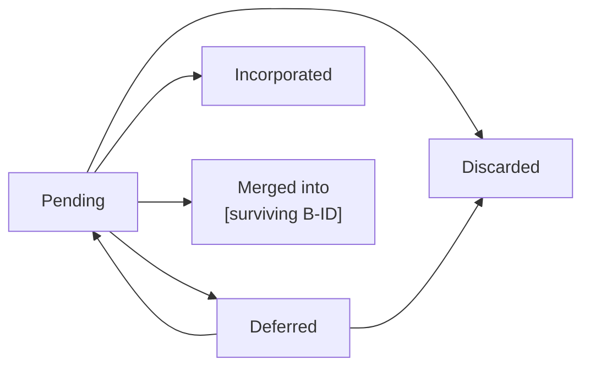

# Backlog

> **Authoring notes (delete when filling in).**
> - The backlog is plain Markdown, optional, and a side channel for deferred opportunities. It has **no frontmatter, no controller contract, no digest, no approval, no generated tail, and no phase gate**. Never run `validate`, `digest`, or `approve` on it.
> - An entry is an option, not approved scope and not a release selection. A backlog entry never defers approved scope or closes a release.
> - IDs are `B` plus three digits (`B001`). A new ID goes above the highest existing number, including retired ones. Never renumber, reuse, or delete an ID to record a disposition.
> - One current row per ID in the register, including items no longer under consideration. The row holds the canonical priority and disposition; notes never do.
> - Priorities: P0 Critical, P1 High, P2 Medium, P3 Low. Use `P2 provisional` only when no priority was given. Within a priority group, new items go last and the existing order stays unless someone explicitly reprioritizes. Every priority change needs a rationale and a source.
> - Dispositions: Pending, Deferred, Incorporated, Discarded, Merged. These are documentary labels, not controller states.
> - Leave unknowns explicit. Never invent owners, estimates, dates, or commitments.
> - Search for a matching item before adding one. Prefer refining an existing row over creating a duplicate.
> - Write content in the project's language. Keep headings and column names. Replace every `[bracketed guide]`, or write `N/A` plus the reason. Prefer tables, lists, and diagrams; keep paragraphs short.
> - **Optional views** (the summary and the lifecycle diagram) are derived readings. If you keep them, update them in the same change as the register and keep them equal to it.
> - Before handoff, check by hand: IDs are unique; original provenance is kept; priority and disposition labels are allowed; significant changes appear in the history; notes match their current rows; partial coverage is explicit; target references are real and distinguish draft, approved, and selected states.

## 1. Purpose and rules

[One or two sentences: what kind of ideas, needs, or opportunities this backlog holds for the project.]

| Rule | Meaning |
|------|---------|
| No prerequisite | Entries need no approved strategy, roadmap, or release. |
| Options only | An entry is not approved scope, a commitment, or a release selection. |
| Stable IDs | `BNNN` identifiers are never reused, renumbered, or deleted. |
| Priority is not selection | Priority orders consideration. Only an approved roadmap selects a release. |
| Unknowns stay explicit | No invented owners, estimates, dates, or commitments. |

| Priority | Level | Use |
|----------|-------|-----|
| P0 | Critical | [When it applies] |
| P1 | High | [When it applies] |
| P2 | Medium | [When it applies; `P2 provisional` when unspecified] |
| P3 | Low | [When it applies] |

| Disposition | Meaning |
|-------------|---------|
| Pending | Captured and still under consideration. |
| Deferred | Explicitly postponed, with the reason and a reconsideration condition. |
| Incorporated | Recorded in a valid spec draft with a verified destination. It does not mean approved, implemented, or delivered. |
| Discarded | Explicitly removed, with the reason kept. |
| Merged | Consolidated into an identified surviving item. |

> Optional lifecycle diagram. Dispositions change only through an explicit decision recorded in section 4.

## 2. Opportunity register

[One sentence: one current row per ID, ordered by priority group. Rows are never deleted to record a disposition.]

**Summary (optional, derived from the table below)**

| Disposition | P0 | P1 | P2 | P3 | Total |
|-------------|----|----|----|----|-------|
| Pending | [n] | [n] | [n] | [n] | [n] |
| Deferred | [n] | [n] | [n] | [n] | [n] |
| Incorporated | [n] | [n] | [n] | [n] | [n] |
| Discarded | [n] | [n] | [n] | [n] | [n] |
| Merged | [n] | [n] | [n] | [n] | [n] |
| **Total** | [n] | [n] | [n] | [n] | [n] |

**Register**

| ID | Opportunity and expected value | Noted date and source | Priority | Disposition | Next decision or reconsideration condition | References |
|----|--------------------------------|-----------------------|----------|-------------|---------------------------------------------|------------|
| B001 | [Problem or opportunity and its expected value, or "value unknown"] | [YYYY-MM-DD; real source: person, meeting, issue, release review] | [P0, P1, P2, or P2 provisional, or P3] | [Pending] | [Open question, or the condition that would bring it back] | [Existing source and destination references, or "None"] |

## 3. Refinement notes

[One sentence: notes add context to an existing ID. They never hold the canonical priority or disposition.]

| ID | Type | Note | Basis |
|----|------|------|-------|
| B001 | [Evidence, Outcome link, Assumption, Dependency, Open question, or Reconsideration condition] | [Useful context only] | [Source or "pending"] |

| ID | Destination | Release | Spec path | Stories and criteria | State |
|----|-------------|---------|-----------|----------------------|-------|
| B001 | [Roadmap or spec, if applicable] | [vX.Y.Z, or "projected vX.Y.Z"] | [.specs/release-vX.Y.Z/spec.md] | [US-001, AC-001] | [Draft, Approved, or Selected, based on evidence] |

- **Destination mapping:** [Use the table only when an item has a destination. If several destinations cover one idea, give one row per destination and state each one's contribution.]
- **Partial coverage:** [An item covered only partly stays Pending or Deferred until the whole opportunity is represented.]
- **Superseded notes:** [Mark replaced notes clearly instead of deleting them.]

## 4. Decision history

[One sentence: append an entry for each significant change of priority, disposition, or destination. Editorial corrections need no entry.]

| Date | Item ID | Decision or change | Reason and evidence | Destination or decision source |
|------|---------|--------------------|---------------------|--------------------------------|
| [YYYY-MM-DD] | [B001] | [What changed, for example "Pending → Deferred" or "P2 → P1"] | [Why, and the supporting evidence] | [Release, spec path, meeting, or person who decided] |

- **Roadmap links:** [Link an item to a release only when an approved roadmap explicitly selects that release. A projected version is labeled as a projection. Selection alone does not make an item Incorporated.]
- **Approved obligations:** [Deferring an approved obligation needs a scope change approved by its owner. A backlog entry cannot do it.]
- **Split or reopened items:** [They keep their history. A split gets new IDs above the highest existing one.]

## 5. Review and references

[One sentence: the backlog is reviewed on request or on agreed triggers. There is no automatic schedule, and age alone never removes an idea.]

| Review item | Value |
|-------------|-------|
| Last review | [YYYY-MM-DD and who, or "none yet"] |
| Next review trigger or cadence | [Agreed event or frequency, or "none agreed"] |
| Pending decisions | [IDs that need a decision, or "None"] |

| Source | Used for |
|--------|----------|
| [Document, issue, meeting notes, or link] | [Which items it supports] |

> This file has no controller contract, generated progress, approval receipt, or phase gate.