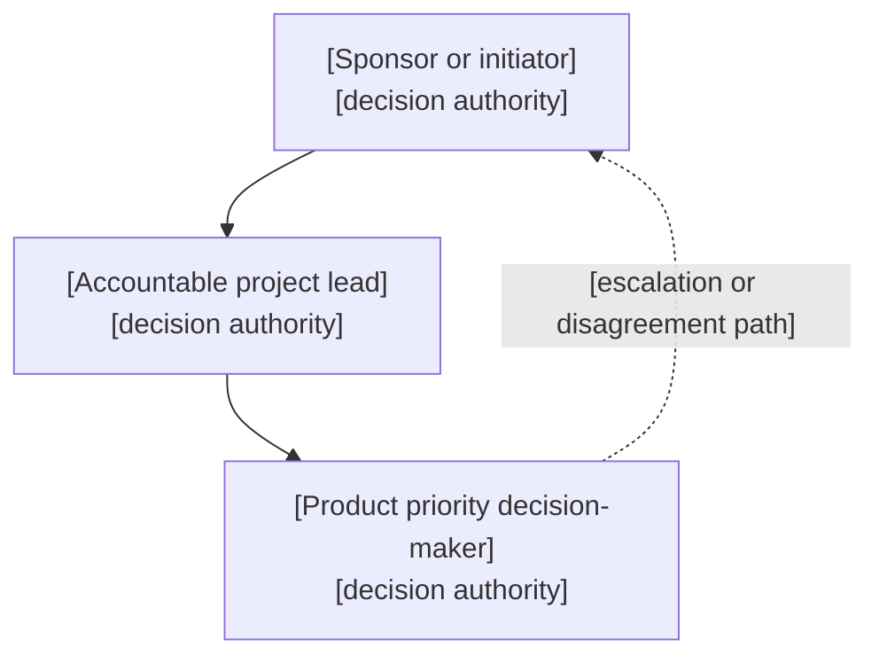
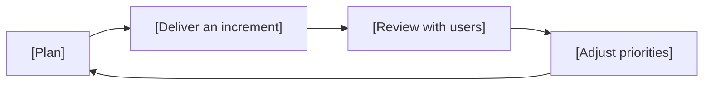

# Project Constitution

> **Authoring notes (delete when filling in).**
> - The constitution is the first approved document and depends on nothing. Its approval sets the project framework only; implementation, integration, and publication keep their own gates.
> - Leave the Approval cell of the revision row as it is. The `approve` operation rewrites it, then records the digest. Add a new revision row with the same marker for each later revision.
> - Write content in the project's language. Keep headings and column names as they are.
> - Replace every `[bracketed guide]` with content, or write `N/A` plus the reason. Keep paragraphs to two or three sentences; prefer tables, lists, and diagrams.
> - Never invent budgets, dates, baselines, or role assignments. Leave unknowns as explicit questions or `pending`.
> - Label each statement as **verified fact**, **hypothesis**, **proposal**, or **approved commitment**.
> - Every MUST rule must be testable.
> - Keep out: component design (architecture), paths (structure), environments (infrastructure), release priorities (roadmap), functional detail (release specs), release-specific risks.
> - Before approving, check that every objective has an indicator, every MUST has a test, and every role has a named person or `pending`.

## Purpose and justification

[One or two sentences: the problem or opportunity and why it merits action now.]

| Problem or opportunity | Why it matters | Evidence or source | Status |
|------------------------|----------------|--------------------|--------|
| [Description] | [Impact on people or the organization] | [Diagnosis, data, or document] | [Verified fact or Hypothesis] |

- **Sponsor objectives served:** [Which organizational or sponsor goals this project advances].

## Vision and beneficiaries

> **Vision:** [One sentence describing the desired future state.]

| Beneficiary | Need | Expected benefit |
|-------------|------|------------------|
| [User, customer, or stakeholder group] | [What they need] | [What improves for them] |

## Objectives and success criteria

[One sentence: objectives are observable outcomes, kept separate from the deliverables that produce them.]

| ID | Objective | Indicator | Baseline | Target | Evaluation point |
|----|-----------|-----------|----------|--------|------------------|
| OBJ-01 | [Desired outcome] | [How it is measured] | [Known value or pending] | [Expected result] | [When it is assessed] |

| Deliverable | Benefit it produces | Objective |
|-------------|---------------------|-----------|
| [Capability or result] | [Benefit] | [OBJ-xx] |

## Scope and boundaries

[One sentence on what the project covers. Detailed functionality belongs in the roadmap and release specs.]

| Category | Items |
|----------|-------|
| Included | [Capabilities or general results in scope] |
| Excluded | [Explicit exclusions, each with a reason] |
| Open to discovery | [Topics deliberately left undecided] |
| Reconsideration triggers | [Conditions that reopen the scope or the project] |

## Principles

[One sentence on how these rules guide decisions. Each MUST must be checkable.]

| ID | Type | Principle | Test or deviation condition |
|----|------|-----------|-----------------------------|
| PRN-01 | MUST | [Lasting, testable rule] | [How compliance is verified] |
| PRN-02 | SHOULD | [Default practice] | [When deviation is acceptable and who decides] |

## Responsibilities and authority

[One sentence on who decides what. Flag when one person holds several roles.]

> Optional diagram. Delete it for a project with one or two roles.

| Role | Person | Decision authority | Requires approval from | Escalation |
|------|--------|--------------------|------------------------|------------|
| [Sponsor, project lead, product decision-maker] | [Name or pending] | [What they decide alone] | [Who must approve the rest] | [Who resolves disagreements] |

- **Combined roles:** [Which roles one person holds, and any conflict that creates].

## Resources, constraints, and assumptions

[One sentence separating what is authorized from what is estimated or pending.]

| Item | Value | Status | Source |
|------|-------|--------|--------|
| [Budget, capacity, mandatory date, or other constraint] | [Amount or pending] | [Authorized, Estimate, or Pending] | [Who set it] |

| Key assumption | How it will be validated | When | Owner |
|----------------|--------------------------|------|-------|
| [Assumption] | [Check or experiment] | [Milestone or date] | [Role or person] |

## Principal risks and uncertainties

[One sentence: include only strategic risks that affect value, viability, or objectives. Release-specific risks belong in release documents.]

| Risk or uncertainty | Possible consequence | Initial validation or response | Owner |
|---------------------|----------------------|--------------------------------|-------|
| [Description] | [Impact] | [Action] | [Role or person] |

## Delivery and learning approach

[One sentence on how increments are delivered and how feedback changes decisions. Reference the roadmap, workflow, and team agreements instead of copying them. Referencing a future document does not authorize creating it early.]

> Optional diagram. Delete it if the table already says everything.

| Practice | Agreement | Where documented |
|----------|-----------|------------------|
| [Increment cadence, user participation, feedback, prioritization] | [Short statement] | [Link or pending] |

- **Direction review criteria:** [What would make the team change course].

## Completion and continuation criteria

[One sentence distinguishing project completion from release acceptance and from the team's definition of done.]

| Completion condition | Evidence | Accepted by |
|----------------------|----------|-------------|
| [What must be true] | [How it is shown] | [Role or person] |

| Decision path | Trigger | Decided by |
|---------------|---------|------------|
| Continue | [Condition] | [Role or person] |
| Redirect | [Condition] | [Role or person] |
| Suspend | [Condition] | [Role or person] |
| Cancel | [Condition] | [Role or person] |

## Approval, references, and amendments

[One sentence: the controller registry, not this prose, is the approval authority. Approval sets the project framework and authorizes no implementation, integration, or publication.]

### Decision references

| Topic | Lives in | Status |
|-------|----------|--------|
| Component design | Architecture | [Exists, pending, or N/A with reason] |
| Execution environments | Infrastructure | [Exists, pending, or N/A with reason] |
| Repository organization | Structure | [Exists, pending, or N/A with reason] |
| Release priorities | Roadmap | [Exists or pending] |
| Team working agreements | [Link] | [Exists or pending] |

### Amendment history

| Revision | Date | Reason | Documents affected | Approval |
|----------|------|--------|--------------------|----------|
| R00 | [YYYY-MM-DD] | [First draft] | [None] | <!-- spec-flow:approval -->Pending approval<!-- /spec-flow:approval --> |

<!-- spec-flow:generated:start -->
Progress is maintained by the Spec-Flow harness.
<!-- spec-flow:generated:end -->
