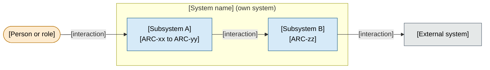
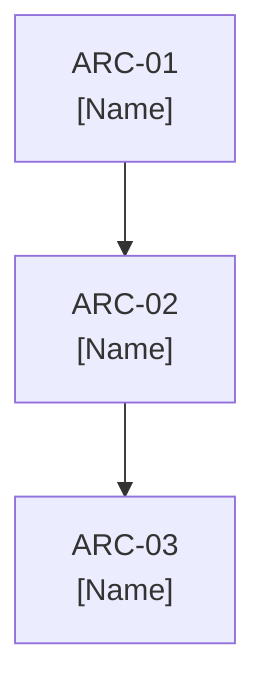
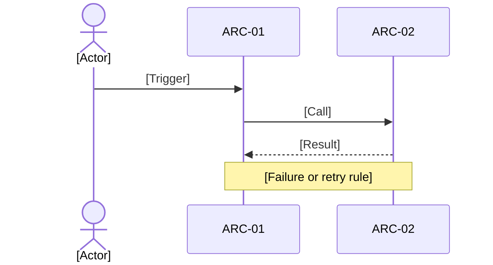

# System Architecture

> **Authoring notes (delete when filling in).**
> - Replace the example digest with the approved constitution digest. Pin other documents only if their decisions are used.
> - Leave the Approval cell of the revision row as it is. The `approve` operation rewrites it, then records the digest. Add a new revision row with the same marker for each later revision.
> - Write content in the project's language. Keep headings and column names as they are.
> - Replace every `[bracketed guide]` with content, or write `N/A` plus the reason. Keep paragraphs to two or three sentences; prefer tables, lists, and diagrams.
> - Label every fact as **verified** (cite evidence) or **proposed**. Approval never proves implementation.
> - Decisions live only in the decisions table (section 9). Other sections cite them by ID.
> - Before approving, check that every `ARC-xx` used here is defined in the components table.

## Purpose, audience, and scope

[One or two sentences: what this document describes and why it exists.]

| Readers | Questions this document answers |
|---------|---------------------------------|
| [Role] | [Question] |

| In scope | Out of scope (where it lives instead) |
|----------|----------------------------------------|
| [Item] | [Item and document: infrastructure, structure, roadmap, or specs] |

**Pinned sources:** [constitution at its digest, plus any other approved document whose decisions are used, and why].

## System context and boundaries

[One sentence describing what the context view shows. Keep people, the own system, and external systems visually distinct.]

| Actor or system | Role | Responsibility outside the system |
|-----------------|------|-----------------------------------|
| [Name] | [What it does for or to the system] | [What the system does not own or guarantee] |

## Current evidence and intended design

[One sentence on what is verified today versus what is proposed.]

| Item | Status | Evidence or source | Date |
|------|--------|--------------------|------|
| [Component, behavior, or fact] | [Verified or Proposed] | [Code, test, document, or inspection] | [YYYY-MM-DD] |

- **Reference evidence:** [External documents consulted and whether they are adopted or only informative].
- **Design in one line:** [The whole approach in a single sentence].

## Quality goals and constraints

[One sentence linking to the constitution objectives these goals come from. Do not copy them.]

| Attribute | Scenario | Expected result | Verification approach |
|-----------|----------|-----------------|-----------------------|
| [Quality attribute] | [Conditions and stimulus] | [Observable response] | [Evidence or planned check] |

| Constraint | Origin | Effect on design |
|------------|--------|------------------|
| [Deadline, budget, team size, policy] | [Constitution section or other source] | [What it rules in or out] |

## Solution strategy

[One sentence: the overall approach and why it fits the goals above.]

| # | Principle | Rationale | Attributes served | Decisions |
|---|-----------|-----------|-------------------|-----------|
| 1 | [Short principle] | [One-sentence reason] | [Quality attributes] | [ADR-Axx] |

## Components, responsibilities, and contracts

[One sentence describing how the system is divided. Group components visually when helpful.]

| ID | Component | Responsibility | Interfaces | Dependencies |
|----|-----------|----------------|------------|--------------|
| ARC-01 | [Name] | [Owned behavior] | [Contract] | [Related IDs or external systems] |

**Contracts that shape the design**

| Between | Contract | Rule |
|---------|----------|------|
| [ARC-xx and ARC-yy] | [Protocol or file or event] | [What is allowed and what is forbidden] |

## Data and runtime scenarios

[One sentence on who owns the data and which paths matter most.]

| Data | Owner | Notes |
|------|-------|-------|
| [Entity or dataset] | [ARC-xx or external system] | [Where it lives, what happens if it is lost] |

| Scenario | Trigger | Main steps | Failure behavior |
|----------|---------|------------|------------------|
| [Name] | [Event or user action] | [Three to six short steps] | [What the state becomes and how to retry] |

**Relevant failures**

| Situation | Effect | Response |
|-----------|--------|----------|
| [What goes wrong] | [Impact on users and data] | [How the system reacts or recovers] |

## Crosscutting concepts

[One sentence on which concerns apply across components. Add domain-specific concerns; mark a concern N/A with a reason when it does not apply. Typical prompts: authentication, authorization, secrets and sensitive data, idempotency, error handling, confirmations for destructive actions, compatibility and versioning, activity logging.]

| Concern | Approach | Applies to |
|---------|----------|------------|
| [Concern] | [Short statement of the shared rule] | [ARC IDs] |

## Decisions and consequences

[One sentence: decisions in this table are approved when this document is approved; approval does not prove implementation. Use the prefix `ADR-A` and keep superseded rows with a replacement reference.]

| ID | Context | Alternatives | Choice and rationale | Consequences | Review condition | Status and provenance |
|----|---------|--------------|----------------------|--------------|------------------|-----------------------|
| ADR-A01 | [Forces and constraints] | [Options considered] | [What was chosen and why] | [Positive and negative effects] | [What would reopen it] | [proposed or approved; who decided, date; related ADRs] |

## Risks, technical debt, and open questions

| Risk or question | Impact | Validation or pending decision |
|------------------|--------|--------------------------------|
| [Risk] | [Consequence] | [Check, proof of concept, or decision needed] |

**Accepted debt:** [List what is knowingly left out, such as missing features or manual steps].

| Open question | Owner | Needed by |
|---------------|-------|-----------|
| [Question] | [Role or person] | [Milestone or date] |

## References and amendment history

| Document | Revision | Digest (first 8 characters) | Purpose |
|----------|----------|-----------------------------|---------|
| [constitution.md](constitution.md) | [R00] | [00000000] | [Pinned source] |
| [Other source] | [n/a] | [n/a] | [Reference only, not a dependency] |

| Revision | Date | Approval | Summary of change |
|----------|------|----------|-------------------|
| R00 | [YYYY-MM-DD] | <!-- spec-flow:approval -->Pending approval<!-- /spec-flow:approval --> | [First draft] |

<!-- spec-flow:generated:start -->
Progress is maintained by the Spec-Flow harness.
<!-- spec-flow:generated:end -->
