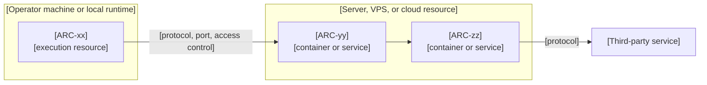

# Infrastructure

> **Authoring notes (delete when filling in).**
> - Replace the example digest with the approved constitution digest. Pin `architecture.md` when this document maps its components to resources.
> - Leave the Approval cell of the revision row as it is. The `approve` operation rewrites it, then records the digest. Add a new revision row with the same marker for each later revision.
> - Write content in the project's language. Keep headings and column names as they are.
> - Replace every `[bracketed guide]` with content, or write `N/A` plus the reason. Keep paragraphs to two or three sentences; prefer tables, lists, and diagrams.
> - **Never write secret values.** Name the secret and where it lives.
> - Separate declared configuration, tested behavior, deployed resources, estimates, and measurements. Documenting a procedure does not authorize running it.
> - Before approving, check that every `ARC-xx` used here exists in `architecture.md`.

## Purpose, audience, and operational scope

[One or two sentences: which components this document places on resources and who reads it.]

| Execution mode | Applies | Notes |
|----------------|---------|-------|
| [Local runtime or host] | [Yes or No] | [Reason or scope] |
| [Servers or VPS] | [Yes or No] | [Reason or scope] |
| [Cloud services] | [Yes or No] | [Reason or scope] |
| [Third-party services] | [Yes or No] | [Reason or scope] |
| [Orchestration, multi-region, hosted CI, or others] | [No] | [Why it is out of scope] |

## Current state and evidence

[One sentence stating when and how the current state was verified.]

| Resource or topic | Observation | Method | Date | State |
|-------------------|-------------|--------|------|-------|
| [Server, service, or setting] | [Fact found] | [Read-only inspection, configuration file, or test] | [YYYY-MM-DD] | [Verified or Proposed] |

- **Unknowns treated as external:** [Anything found but not understood, and how it is handled].
- **Everything not listed above is proposed:** [Confirm that approval does not prove deployment].

## Environments and resources

[One sentence on how environments differ. Include third-party services as resources.]

| Environment | Platform or resource | Purpose | Owner | State and evidence |
|-------------|----------------------|---------|-------|--------------------|
| [Name] | [Resource] | [Use] | [Role or person] | [Verified or proposed; reference] |

## Deployment mapping and connections

[One sentence describing how components reach their resources and each other.]

| Components | Execution resource | Connections | Exposure and network controls |
|------------|--------------------|-------------|-------------------------------|
| [ARC IDs sharing a resource] | [Container, VM, service, or process] | [Other components or external systems] | [Published ports, domains, TLS, or private only] |

**Variants by mode**

| Mode or variant | Publishing | Management access | Notes |
|-----------------|------------|-------------------|-------|
| [Name] | [How traffic reaches the system] | [How operators reach it] | [Differences to know] |

## Configuration, access, and secrets

[One sentence on how configuration and access are controlled.]

| Setting | Scope | Purpose | Where defined |
|---------|-------|---------|---------------|
| [Variable or setting name] | [Environment or component] | [What it controls] | [File, variable, or console] |

| Principal | Access granted | Mechanism | Boundary |
|-----------|----------------|-----------|----------|
| [User, service, or role] | [What it can do] | [Key, token, role] | [What limits it] |

| Secret | Where it lives | Protection | Rotation |
|--------|----------------|------------|----------|
| [Name only, never the value] | [Secure location] | [Encryption or access control] | [Frequency or pending] |

## Build, distribution, deployment, and rollback

[One sentence on how code becomes a running system.]

| Artifact | Build | Distribution | Deployment | Rollback |
|----------|-------|--------------|------------|----------|
| [Image, binary, script, or package] | [How and where] | [Registry, file, or none] | [Who or what deploys it] | [How to go back] |

| CI step | Check | Blocking | Limits |
|---------|-------|----------|--------|
| [Step] | [Lint, tests, secret scan, image build] | [Yes or No] | [What it cannot cover] |

- **Continuous delivery:** [Present or absent, and why].
- **Verification plan (proposed, untested):** [List the checks that will prove the delivery path works].

## Observability and operations

[One sentence on what is monitored and what is intentionally excluded.]

| Signal or condition | Objective or threshold | Response | Owner | Procedure |
|---------------------|------------------------|----------|-------|-----------|
| [Metric, log, alert, or condition] | [Agreed value or pending] | [Action] | [Role or person] | [Reference or pending] |

- **Where logs live:** [Location and retention].
- **Excluded for now:** [Alerts, dashboards, or tools not covered].

## Capacity, limits, and costs

[One sentence on the load assumptions behind these numbers.]

| Estimate | Value | Basis | Status |
|----------|-------|-------|--------|
| [Resource need] | [Number] | [Source or assumption] | [Estimate, not measured] |

| Measurement | Value | Date | Source |
|-------------|-------|------|--------|
| [Observed figure] | [Number] | [YYYY-MM-DD] | [Tool or inspection] |

| External limit | Provider | Verified |
|----------------|----------|----------|
| [Quota or restriction] | [Service] | [Yes or No] |

| Cost item | Estimate | Needs approval |
|-----------|----------|----------------|
| [Domain, storage, server, service] | [Amount or pending] | [Yes or No] |

## Backup, restoration, and recovery

[One sentence on what must survive a failure.]

| Data or state | Protection | Frequency and retention | Restore procedure |
|---------------|------------|-------------------------|-------------------|
| [Dataset] | [Mechanism and destination] | [Schedule and keep period] | [Reference or pending] |

| Scope | Recovery point objective (RPO) | Recovery time objective (RTO) | Basis |
|-------|-------------------------------|-------------------------------|-------|
| [Data or service] | [Tolerable data loss or not set] | [Restoration time or not set] | [Why this value] |

| Recovery test | Status | Evidence |
|---------------|--------|----------|
| [Restore, migration rehearsal, rebuild] | [Planned or Done] | [Result reference or pending] |

> A completed or hash-verified backup does not prove a tested restoration. Record restoration tests separately.

## Decisions, risks, and operational questions

[One sentence: use the prefix `ADR-I`; decisions are approved when this document is approved. Keep superseded rows with a replacement reference.]

| ID | Context | Alternatives | Choice and rationale | Consequences | Review condition | Status and provenance |
|----|---------|--------------|----------------------|--------------|------------------|-----------------------|
| ADR-I01 | [Forces and constraints] | [Options considered] | [What was chosen and why] | [Positive and negative effects] | [What would reopen it] | [proposed or approved; who decided, date; related ADRs] |

| Risk or question | Impact | Action |
|------------------|--------|--------|
| [Risk] | [Consequence] | [Mitigation, proof of concept, or decision needed] |

## References and amendment history

| Document | Revision | Digest (first 8 characters) | Purpose |
|----------|----------|-----------------------------|---------|
| [constitution.md](constitution.md) | [R00] | [00000000] | [Pinned source] |
| [architecture.md](architecture.md) | [R00] | [00000000] | [Pinned source; component IDs] |
| [Procedure or configuration file] | [n/a] | [n/a] | [Reference only] |

| Revision | Date | Approval | Summary of change |
|----------|------|----------|-------------------|
| R00 | [YYYY-MM-DD] | <!-- spec-flow:approval -->Pending approval<!-- /spec-flow:approval --> | [First draft] |

<!-- spec-flow:generated:start -->
Progress is maintained by the Spec-Flow harness.
<!-- spec-flow:generated:end -->
