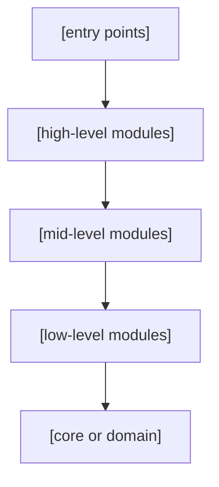

# Code Structure

> **Authoring notes (delete when filling in).**
> - Replace the example digest with the approved constitution digest. Pin `architecture.md` when paths map its components, and `infrastructure.md` only when deployment files or distribution rules are used.
> - Write content in the project's language. Keep headings and column names as they are.
> - Replace every `[bracketed guide]` with content, or write `N/A` plus the reason. Keep paragraphs to two or three sentences; prefer tables, lists, trees, and diagrams.
> - Build the **verified** tree from inspected paths only. Never show a proposed path as existing.
> - Approval does not create directories or implement anything.
> - Before approving, check that every `ARC-xx` used here exists in `architecture.md` and every path in the mapping appears in a tree.

## Purpose, audience, and scope

[One or two sentences: what readers can locate or decide with this document.]

| Readers | What they should be able to do |
|---------|--------------------------------|
| [Role] | [Find where a responsibility lives, place a new change, check allowed dependencies] |

| In scope | Out of scope (where it lives instead) |
|----------|----------------------------------------|
| [Repository organization, modules, placement and naming rules, dependency limits, distributable artifacts] | [Component design: architecture. Execution resources: infrastructure. Implementation tasks: release plans] |

## Verified current organization

[One sentence stating when and how the repository was inspected.]

- **Date and method:** [YYYY-MM-DD, commands or files inspected].
- **Findings:** [Empty repository, existing code, build files, commit state].
- **Omissions:** [Directories left out of the tree, such as downloaded dependencies or generated output].

```text
project/
├── src/                 # Product source
├── tests/               # Tests
└── docs/                # Documentation
```

> Replace the illustrative tree with verified paths. It does not prescribe a `src/` layout. For an empty repository, state the verified absence instead.

## Architecture-to-repository mapping

[One sentence: state whether the paths below are verified or proposed.]

| Component or responsibility | Path | Current or proposed state | Entry point |
|-----------------------------|------|---------------------------|-------------|
| [ARC-01 or a responsibility with no component ID] | [relative/path] | [Verified or Proposed] | [File or symbol] |

- **Rows without a component ID:** [domain types, configuration, secrets location, CI, docs, scripts].

## Intended organization and placement rules

[One sentence naming the organizing principle: by component, layer, feature, domain, or other, and why it fits the architecture.]

```text
project/
├── [proposed directory]/    # [Purpose] (proposed)
└── [proposed directory]/    # [Purpose] (proposed)
```

> Label this tree **proposed**. If no change is needed, say so and delete it.

| Path or category | Contents | Placement rule | Restrictions |
|------------------|----------|----------------|--------------|
| [relative/path or category] | [Purpose] | [Where a new element belongs and why] | [Boundary] |

## Naming conventions and public interfaces

[One sentence on how names signal ownership and stability.]

| Surface | Convention | Example |
|---------|------------|---------|
| [Source files, packages, API routes, labels, environment variables, components] | [Rule] | [Concrete example] |

| Entry point | Path | Role |
|-------------|------|------|
| [Program, script, or file] | [relative/path] | [What starts here] |

- **Public interfaces:** [Which surfaces are public and which are internal].

## Dependencies and module boundaries

[One sentence stating the dependency direction. Arrows mean "may depend on".]



| From | May depend on | Must not depend on | Verification |
|------|---------------|--------------------|--------------|
| [Module or layer] | [Allowed targets] | [Forbidden targets] | [Linter rule, test, or pending] |

## Tests, configuration, documentation, and resources

[One sentence on where supporting files live and how they connect to components.]

| Category | Location | Relationship to components | Command or check |
|----------|----------|----------------------------|------------------|
| [Unit tests] | [Path pattern] | [Next to the code they test] | [Command] |
| [Integration tests] | [Path] | [What they need to run] | [Command] |
| [Configuration] | [Path] | [Which component reads it] | [Check] |
| [Documentation] | [Path] | [What it covers] | [n/a] |
| [Resources and templates] | [Path] | [Who uses them] | [n/a] |

## Generated files, third parties, and distribution

[One sentence on what is edited by hand and what is produced.]

| Category | Contents | Treatment |
|----------|----------|-----------|
| Editable sources | [Paths] | [Versioned] |
| Generated | [Paths] | [Not versioned; build order or caveats] |
| Local, not versioned | [Secrets, local configuration, local data] | [Excluded from Git and build context] |
| Third parties | [Dependencies and lock files] | [Lock files versioned, downloads not] |
| Distributable | [Images, binaries, scripts] | [How they are built; link to infrastructure] |

## Decisions, risks, and pending structural changes

[One sentence: use the prefix `ADR-S`; decisions are approved when this document is approved. Keep superseded rows with a replacement reference.]

| ID | Context | Alternatives | Choice and rationale | Consequences | Review condition | Status and provenance |
|----|---------|--------------|----------------------|--------------|------------------|-----------------------|
| ADR-S01 | [Forces and constraints] | [Options considered] | [What was chosen and why] | [Positive and negative effects] | [What would reopen it] | [proposed or approved; who decided, date; related ADRs] |

| Risk or pending change | Impact | Action |
|------------------------|--------|--------|
| [Risk or structural change not yet made] | [Consequence] | [Mitigation or decision needed] |

## References and amendment history

| Document | Revision | Digest (first 8 characters) | Purpose |
|----------|----------|-----------------------------|---------|
| [constitution.md](constitution.md) | [R00] | [00000000] | [Pinned source] |
| [architecture.md](architecture.md) | [R00] | [00000000] | [Pinned source; component IDs] |
| [infrastructure.md](infrastructure.md) | [R00] | [00000000] | [Pinned only if deployment files are used] |

| Revision | Date | Approval | Summary of change |
|----------|------|----------|-------------------|
| R00 | [YYYY-MM-DD] | [Who approved, where recorded] | [First draft] |

<!-- spec-flow:generated:start -->
Progress is maintained by the Spec-Flow harness.
<!-- spec-flow:generated:end -->
