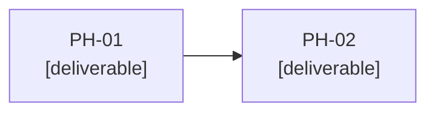
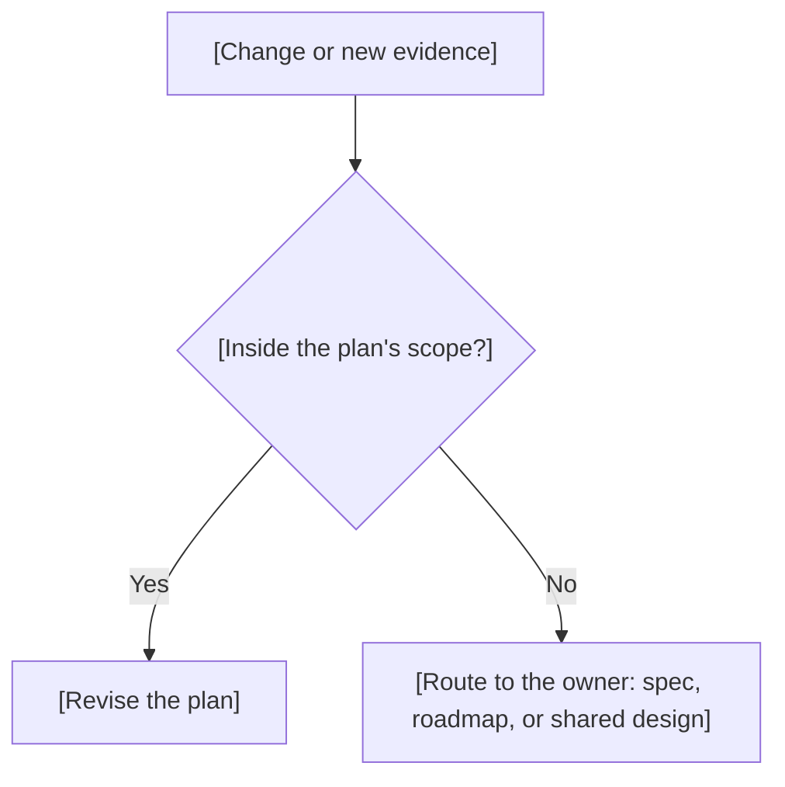

# Release Plan: vX.Y.Z

> **Authoring notes (delete when filling in).**
> - The frontmatter `phases` array is the only phase sequence. Section 3 holds its reading table: same phases, same order, same descriptions and dependency IDs, with `None` for an empty list. Never keep a second sequence.
> - Phase IDs are `PH-` plus at least two digits. The graph must be acyclic and match the intended order. Justify enabling technical phases by what they unlock. Do not defer testing to a final phase.
> - The plan never redefines spec behavior, acceptance criteria, or roadmap priorities. Route changes to their owner: behavior to the spec, priorities to the roadmap, shared decisions to their documents.
> - Every canonical `AC` needs an intended delivery phase and a final verification. Quality obligations and constitution MUST rules need a planned check. A MUST violation blocks tasks.
> - Phase and file tables give planning context only. They do not authorize starting work; tasks hold exact file lists and commands.
> - Pin the spec, plus other approved sources only when they directly shape the plan. Leave unknown decisions, capacity, and estimates explicit; never invent them.
> - Leave the Approval cell of the revision row as it is. The `approve` operation rewrites it, then records the digest. Add a new revision row with the same marker for each later revision.
> - Write content in the project's language. Keep headings and column names. Replace every `[bracketed guide]`, or write `N/A` plus the reason. Prefer tables, lists, and diagrams; keep paragraphs short.
> - Before approving, check by hand: the table matches the array, every `AC` appears in section 7, and no blocking question remains open.

## Purpose, scope, and approved bases

[One or two sentences: the release, its approved spec, and what this plan sets out to deliver.]

| Field | Value |
|-------|-------|
| Release | [vX.Y.Z] |
| Approved spec | [spec.md, revision] |
| Objective | [Release objective from the roadmap] |
| Boundaries | [What this plan covers; spec behavior is not redefined here] |

| Approved base | Revision | Decision used |
|---------------|----------|---------------|
| Constitution | [R00] | [Principles that constrain the plan] |
| [Architecture, infrastructure, or structure, if applicable] | [R00] | [Decision that shapes the approach] |

## Technical approach and implementation decisions

[One or two sentences summarizing the approach for this release.]

| Statement | Type | Evidence |
|-----------|------|----------|
| [Fact, assumption, or proposal] | [Verified fact, Assumption, or Proposal] | [Source or pending] |

| ID | Context | Alternatives | Choice and rationale | Consequences | Review condition | Status and provenance |
|----|---------|--------------|----------------------|--------------|------------------|-----------------------|
| ADR-P01 | [Forces and constraints] | [Options considered] | [What was chosen and why] | [Positive and negative effects] | [What would reopen it] | [proposed or approved; who decided, date] |

> A change to shared design goes to its owning document, not to this table.

## Phases, deliverables, and dependencies

[One sentence: the table is a reading view of the `phases` array. Organize phases around verifiable increments.]

> Optional diagram of the dependency graph. It must match the array.

| Phase | Goal and deliverable | Dependencies | Related stories | Related criteria |
|-------|----------------------|--------------|-----------------|------------------|
| PH-01 | [Same text as the array description] | None | [US-001] | [AC-001, AC-002, AC-003] |
| PH-02 | [Same text as the array description] | [PH-01] | [US-002] | [AC-004] |

- **Ordering rationale:** [Why this order; enabling phases and what they unlock].
- **Criteria spanning phases:** [Which criteria span several phases, and where each partial contribution ends].

## Components, files, and change scope

[One sentence on where changes are expected. Distinguish existing from proposed paths; this table authorizes no writes.]

| Component or path | Intended change | Phase | Restrictions or dependencies |
|-------------------|-----------------|-------|------------------------------|
| [Component reference or relative/path] | [Create, modify, or remove] | [PH-xx] | [Conditions, boundaries from structure] |

## Capacity, resources, and forecasts

[One sentence on what is available and how certain it is. Do not assume independent work runs in parallel.]

| Resource | Availability | Basis | Uncertainty |
|----------|--------------|-------|-------------|
| [People, tools, environments, access] | [Amount or pending] | [Source] | [Low, Medium, or High, with reason] |

| Phase | Estimate | Basis | Type |
|-------|----------|-------|------|
| [PH-xx] | [Effort or duration, or pending] | [How it was estimated] | [Forecast or Commitment] |

## Risks, assumptions, and validation

[One sentence: prioritize validation that reduces the most important uncertainty. Keep each item planned until evidence exists.]

| Risk or assumption | Consequence | Response or validation | Point or phase | Expected evidence |
|--------------------|-------------|------------------------|----------------|-------------------|
| [Description] | [Impact] | [Intended action] | [PH-xx] | [Observable result] |

## Compliance and verification strategy

[One sentence: this table is intended coverage, not evidence. Commands and inspections belong in tasks.]

| Reference | Delivery or verification phase | Verification approach | Expected evidence |
|-----------|--------------------------------|-----------------------|-------------------|
| AC-001 | [PH-xx, delivery and final verification] | [General method] | [Observable result] |
| NFR-001 → AC-003 | [PH-xx, delivery and final verification] | [Quality check against the spec threshold] | [Measured result] |
| [Constitution MUST reference] | [PH-xx] | [Review or check] | [Evidence] |

- **Partial contributions:** [Phases that contribute to a criterion without finishing it, labeled separately from final verification].
- **Uncovered obligations:** [Prose-only quality obligations without an `AC`; return them to the spec].

## Operational delivery preparation

[One sentence separating technical readiness from authorization to integrate, publish, or deploy.]

| Area | Applies | Preparation | Rollback or N/A reason |
|------|---------|-------------|------------------------|
| Packaging | [Yes or N/A] | [What is prepared] | [Rollback or reason] |
| Installation and configuration | [Yes or N/A] | [What is prepared] | [Rollback or reason] |
| Compatibility and migration | [Yes or N/A] | [What is prepared] | [Rollback or reason] |

## Review, learning, and adaptation

[One sentence on how evidence can change the plan. Completed work and history are preserved when the plan changes.]

| Trigger | Evidence | Adjustment inside the plan | Route to owner when it exceeds the plan |
|---------|----------|----------------------------|------------------------------------------|
| [Event or finding] | [What would be observed] | [Allowed change] | [Spec, roadmap, or design document] |

## Open questions and readiness for tasks

[One sentence: do not create tasks to hide open decisions.]

| Open question | Blocks tasks | Owner | Needed by |
|---------------|--------------|-------|-----------|
| [Question] | [Yes or No] | [Role or person] | [Date or phase] |

| Readiness check | Result | Note |
|-----------------|--------|------|
| Approved bases are current | [Met, Not met, or N/A] | [Comment] |
| Approach defined enough for tasks | [Result] | [Comment] |
| Phases coherent and acyclic; table matches array | [Result] | [Comment] |
| Every criterion, quality rule, and MUST has planned coverage | [Result] | [Comment] |
| File scope and resources understood | [Result] | [Comment] |
| Risks have responses; no blocking question remains | [Result] | [Comment] |

## References, approval, and amendments

[One sentence: the controller registry is the approval authority. Plan approval permits the tasks gate only; it proves no implementation and authorizes no publication or deployment.]

| Document | Revision | Digest (first 8 characters) | Purpose |
|----------|----------|-----------------------------|---------|
| [spec.md](spec.md) | [R00] | [00000000] | [Pinned source] |
| [Other source] | [n/a] | [n/a] | [Reference only] |

| Revision | Date | Approval | Summary of change | Documents affected |
|----------|------|----------|-------------------|--------------------|
| R00 | [YYYY-MM-DD] | <!-- spec-flow:approval -->Pending approval<!-- /spec-flow:approval --> | [First draft] | [None] |

<!-- spec-flow:generated:start -->
Progress is maintained by the Spec-Flow harness.
<!-- spec-flow:generated:end -->
