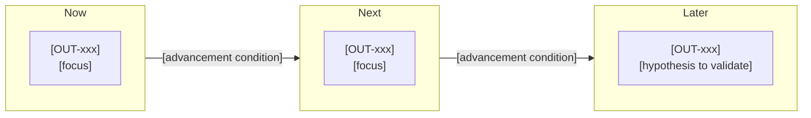
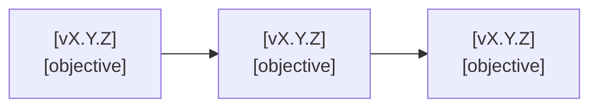

# Product Roadmap

> **Authoring notes (delete when filling in).**
> - The `releases` array in the frontmatter is the only source of versions, order, objectives, and statuses. The reading table in section 6 must mirror it exactly: same count, same order, same objective and status text. The controller validates only the array, never this table, so you must compare them by hand.
> - Versions are strict numeric `vX.Y.Z`, agreed with the user. The example versions and row counts are illustrative; replace them with real projections.
> - Canonical statuses are `planned`, `active`, `completed`, `deferred`, `cancelled`. The labels Projected, Selected, and Not selected are contextual and are neither statuses nor permission to execute.
> - Choosing the next release is a human decision. Never infer it from array position, horizon, or `planned` status. Keep at most one selected release and one active release.
> - Pin the constitution, plus any design document whose decisions are used. Record `N/A` with a reason for design documents that do not apply; omitting a pin alone is not N/A.
> - Keep `status: draft` in the header. The `approve` operation sets it to `approved` and then records the digest; the status is outside the digest. Set it back to `draft` when you start a new revision. Never write approval state in the prose.
> - Write content in the project's language. Keep headings and column names. Replace every `[bracketed guide]`, or write `N/A` plus the reason. Prefer tables, lists, and diagrams; keep paragraphs short.
> - Before approving, check by hand (the controller does not): row count, unique versions, order, exact objective and status matches, known OUT IDs, that the Selected label matches section 7 and its text does not say the selection is still open, and that every other table keeps its own columns (no rows pasted from another table) with each outcome linked to its constitution objective.

## Purpose, audience, and scope

[One or two sentences: what this roadmap plans and the horizon it covers.]

| Readers | Decisions this roadmap supports |
|---------|---------------------------------|
| [Role] | [Decision] |

- **Product or initiative covered:** [Name and boundaries].
- **Planning horizon:** [Period or milestone].

## Direction and approved bases

[One sentence on the approved sources this roadmap builds on.]

| Source | Revision | Pinned | What the roadmap takes from it |
|--------|----------|--------|--------------------------------|
| Constitution | [R00] | Yes | [Objectives, beneficiaries, boundaries, constraints] |
| [Other approved source] | [R00] | [Yes or No] | [Constraint or decision used] |

| Design document | Applies | Reason or constraint |
|-----------------|---------|----------------------|
| Architecture | [Yes or N/A] | [Reason or constraint on releases] |
| Infrastructure | [Yes or N/A] | [Reason or constraint on releases] |
| Structure | [Yes or N/A] | [Reason or constraint on releases] |

## Desired outcomes and measurement

[One sentence: outcomes describe benefits, not capabilities. Pending values stay explicit.]

| ID | Desired outcome | Beneficiaries | Indicator | Baseline | Target | Evaluation |
|----|-----------------|---------------|-----------|----------|--------|------------|
| OUT-001 | [Desired improvement] | [Users or stakeholders] | [Measure] | [Known value or pending] | [Target or pending] | [When and how] |

| Outcome | Constitution objective | Relationship |
|---------|------------------------|--------------|
| [OUT-001] | [OBJ-xx] | [How it advances the objective] |

## Prioritization criteria and rationale

[One sentence on how value, urgency, effort, capacity, risk, dependencies, learning, and constraints are weighed.]

| Criterion | Weight or order | Meaning |
|-----------|-----------------|---------|
| [Criterion] | [Rank or weight] | [What it captures] |

| Option considered | Advantages | Disadvantages | Outcome |
|-------------------|------------|---------------|---------|
| [Ordering alternative] | [Pros] | [Cons] | [Chosen or Not chosen] |

[Optional: add a scoring table only if the team agreed on scoring.]

## Horizons and uncertainty

[One sentence on how the work is grouped by confidence. Do not list releases here.]

| Horizon | Focus | Hypotheses to validate | Advancement condition | Dates and type |
|---------|-------|------------------------|-----------------------|----------------|
| Now | [Outcomes] | [Hypothesis] | [Condition] | [Date, labeled mandatory, committed, or forecast] |
| Next | [Outcomes] | [Hypothesis] | [Condition] | [Date and type or pending] |
| Later | [Outcomes] | [Hypothesis] | [Condition] | [Date and type or pending] |

## Release projections and sequence

[One sentence: the frontmatter `releases` array owns this content; the table is its reading view, in the same order.]

| Version | Horizon | Expected contribution | General capabilities | Canonical status | Selection |
|---------|---------|-----------------------|----------------------|------------------|-----------|
| v1.0.0 | Now | [Same text as the array objective] | [Minimum capabilities] | planned | Projected |
| v1.1.0 | Next | [Same text as the array objective] | [Expected capabilities] | planned | Projected |
| v2.0.0 | Later | [Same text as the array objective] | [Capabilities to validate] | planned | Projected |

> Optional diagram. If kept, it must match the array and the table.

| Version | OUT-001 | OUT-002 |
|---------|---------|---------|
| [vX.Y.Z] | [Contributes or blank] | [Contributes or blank] |

- **Grouping and ordering rationale:** [Why releases are grouped and sequenced this way].
- **Dependencies by version:** [Version-keyed ordering constraints].
- **Retained but not projected:** [Releases marked Not selected, and why].

## Next selected release

[One sentence: selection permits only the applicable document gates. It does not authorize implementation or publication.]

| Field | Value |
|-------|-------|
| Selected version | [One canonical version chosen with the user, or "None selected yet"] |
| Reason | [Why this release goes next] |
| Pending questions | [Open points before its spec] |
| Table label | [Selected, matching section 6] |

## Capacity, dependencies, and risks

[One sentence separating confirmed constraints from assumptions.]

| Capacity or resource | Availability | Status |
|----------------------|--------------|--------|
| [People, time, budget] | [Amount or pending] | [Confirmed or Assumption] |

| Dependency | Type | Needed by | Status |
|------------|------|-----------|--------|
| [External decision, system, or team] | [External, Internal, or Release] | [Version or date] | [Open, Confirmed, or Blocked] |

| Risk or uncertainty | Impact | Response | Owner |
|---------------------|--------|----------|-------|
| [Description] | [Consequence] | [Action] | [Role or person] |

## Deferred opportunities and exclusions

[One sentence: deferrals here differ from the constitution's exclusions.]

| Opportunity | Link | Reason deferred | Reconsideration condition |
|-------------|------|-----------------|---------------------------|
| [Idea or request] | [Backlog item or none] | [Why not now] | [What would bring it back] |

## Review, evidence, and learning

[One sentence on how the roadmap is reviewed and corrected.]

| Owner | Participants | Cadence | Triggers for an extra review |
|-------|--------------|---------|------------------------------|
| [Role or person] | [Roles] | [Frequency] | [Events] |

| Release | Delivery verified | Outcome measured | Impact |
|---------|-------------------|------------------|--------|
| [vX.Y.Z] | [Link to review evidence or pending] | [Measurement or pending] | [Pending or Observed] |

## References, approval, and amendments

[One sentence: the controller registry is the approval authority. Approval covers intent and sequence, not detailed scope. Any substantive change needs a new revision.]

| Document | Revision | Digest (first 8 characters) | Purpose |
|----------|----------|-----------------------------|---------|
| [constitution.md](constitution.md) | [R00] | [00000000] | [Pinned source] |
| [Other source] | [n/a] | [n/a] | [Reference only] |

| Revision | Date | Approval | Scope or priority change | Documents affected |
|----------|------|----------|--------------------------|--------------------|
| R00 | [YYYY-MM-DD] | Header status and registry | [First draft] | [None] |

<!-- spec-flow:generated:start -->
Progress is maintained by the Spec-Flow harness.
<!-- spec-flow:generated:end -->
