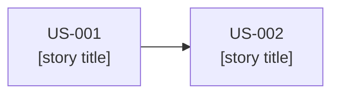
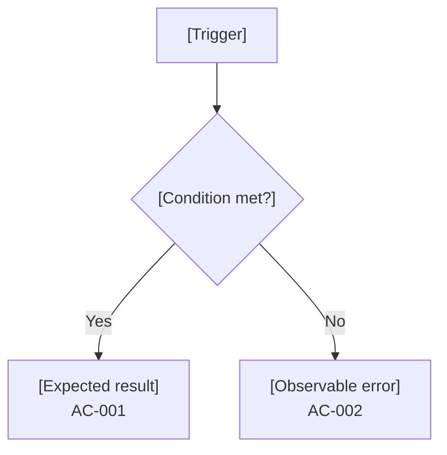

# Release Spec: vX.Y.Z

> **Authoring notes (delete when filling in).**
> - The frontmatter `stories` and `acceptance` arrays are the only canonical definitions. Tables below reference their IDs and never restate or add criteria.
> - IDs use `US-` or `AC-` plus at least three digits. Each criterion has exactly one owning story and is falsifiable. Dependencies between stories never transfer criterion ownership.
> - Keep stories bounded and independently testable; split oversized ones by user value. Do not create a story just to relabel a technical task.
> - Any required behavior that appears in a table, error case, or compatibility note must also be added to canonical acceptance in the same revision. Quality obligations that need checking must be reachable from an `AC`; prose-only obligations are not covered by the controller.
> - Never infer the release from a `planned` status, array position, or directory number. The approved roadmap must select this exact version.
> - Keep `status: draft` in the header. The `approve` operation sets it to `approved` and then records the digest; the status is outside the digest. Set it back to `draft` when you start a new revision. Never write approval state in the prose.
> - Write content in the project's language. Keep headings and column names. Replace every `[bracketed guide]`, or write `N/A` plus the reason. Prefer tables, lists, and diagrams; keep paragraphs short.
> - Before approving, check by hand (the controller checks structure only): every story appears once in section 5, in the same order as the array; only known `OUT` IDs are cited; every `AC` sits under its real story; thresholds agree across sections.

## Purpose and selected release

[One or two sentences: why this release exists and the value it delivers.]

| Field | Value |
|-------|-------|
| Release version | [vX.Y.Z, explicitly selected] |
| Roadmap entry | [Objective text and canonical status from the approved roadmap] |
| Selection evidence | [Where the approved roadmap records the selection] |
| Delivery purpose | [What users can do after this release] |

## Users, context, and expected outcome

[One sentence on who benefits and in what situation. Use real actors; do not invent upstream goals.]

| Actor | Need | Situation | Related outcomes |
|-------|------|-----------|------------------|
| [User or role] | [What they need] | [When and where they need it] | [OUT-xxx] |

| Outcome | Contribution of this release |
|---------|------------------------------|
| [OUT-xxx] | [Measurable contribution, consistent with the roadmap] |

## Scope and exclusions

[One sentence stating that the release is a coherent increment.]

| Category | Items |
|----------|-------|
| Included | [Capabilities and results delivered] |
| Excluded | [What this release does not do, each with a reason] |
| Deferred | [Work moved to later releases or the backlog] |

## Approved bases and constraints

[One sentence: reference approved sources; never copy their text. Pin only sources actually used.]

| Source | Revision | Constraint or decision used |
|--------|----------|-----------------------------|
| Roadmap | [R00] | [Release objective and outcomes] |
| Constitution | [R00] | [Principles and constraints that apply] |
| [Architecture, infrastructure, or structure, if used] | [R00] | [Decision that shapes this release] |

## User stories

[One sentence on how the stories fit together. Canonical text lives in the frontmatter.]

> Optional diagram of real dependencies between stories. Dependencies never move criteria between stories.

| Story | Related outcomes | Acceptance criteria | Relevant dependencies |
|-------|------------------|---------------------|-----------------------|
| US-001 | [OUT-xxx] | [AC-001, AC-002, AC-003] | [None or story IDs with reason] |
| US-002 | [OUT-xxx] | [AC-004] | [None or story IDs with reason] |

## Rules, acceptance, and examples

[One sentence: this table illustrates the canonical criteria with situations. It does not define new ones. Given/When/Then wording is optional.]

| Criterion | Situation or input | Action or event | Expected result |
|-----------|--------------------|-----------------|-----------------|
| AC-001 | [Valid situation] | [What the user or system does] | [Observable result] |
| AC-002 | [Invalid input or failure] | [What happens] | [Observable error behavior] |
| AC-003 | [Quality condition from NFR-001] | [Measured action] | [Threshold met] |
| AC-004 | [Situation for the second story] | [What happens] | [Observable result] |

## Quality and conditions of done

[One sentence on release-specific quality requirements. Reference shared done conditions instead of copying them; write N/A with a reason when none apply.]

| ID | Attribute | Conditions | Result or threshold | Verification approach | Related criteria |
|----|-----------|------------|---------------------|-----------------------|------------------|
| NFR-001 | [Performance, security, accessibility, other] | [Load, data, environment] | [Measurable target] | [Test, inspection, or measurement] | [AC-003] |

## Edge cases, errors, and compatibility

[One sentence on failure behavior users can observe. Implementation procedures belong in the plan.]

| Case | Trigger | Observable behavior | Criterion |
|------|---------|---------------------|-----------|
| [Edge or error case] | [What causes it] | [What the user sees or the system does] | [AC-xxx] |

| Compatibility or data obligation | Affected interface or data | Criterion |
|----------------------------------|----------------------------|-----------|
| [Obligation] | [What it touches] | [AC-xxx] |

## Post-delivery measurement

[One sentence separating technical acceptance, delivery, and observed impact.]

| Roadmap indicator | Target | Source | Method | Timing | Owner |
|-------------------|--------|--------|--------|--------|-------|
| [OUT-xxx indicator] | [Target from the roadmap] | [Where the data comes from] | [How it is measured] | [When] | [Role or person] |

| Level | What it shows | Status |
|-------|---------------|--------|
| Technical acceptance | [All criteria verified] | [Pending] |
| Delivery | [Released and available to users] | [Pending] |
| Observed impact | [Indicator moved as targeted] | [Pending] |

## Assumptions, dependencies, and open questions

[One sentence on what could change this spec. Technical choices may stay open for the plan.]

| Assumption | Consequence if false | Validation |
|------------|----------------------|------------|
| [Assumption] | [Impact] | [How and when it is checked] |

| Dependency | Type | Needed by | Status |
|------------|------|-----------|--------|
| [External decision, system, or team] | [External or Internal] | [Date or phase] | [Open, Confirmed, or Blocked] |

| Open question | Blocks planning | Owner |
|---------------|-----------------|-------|
| [Question] | [Yes or No] | [Role or person] |

## Readiness for planning, approval, and amendments

[One sentence: approval covers progression through the plan gate only. It authorizes no implementation, integration, or publication.]

| Readiness check | Result | Note |
|-----------------|--------|------|
| Release selected in the approved roadmap | [Met, Not met, or N/A] | [Comment] |
| Every story bounded and independently testable | [Result] | [Comment] |
| Every criterion falsifiable and owned by one story | [Result] | [Comment] |
| Quality obligations reachable from criteria | [Result] | [Comment] |
| No blocking open questions | [Result] | [Comment] |

| Document | Revision | Digest (first 8 characters) | Purpose |
|----------|----------|-----------------------------|---------|
| [roadmap.md](../roadmap.md) | [R00] | [00000000] | [Pinned source] |

| Revision | Date | Approval | Summary of change | Documents affected |
|----------|------|----------|-------------------|--------------------|
| R00 | [YYYY-MM-DD] | Header status and registry | [First draft] | [None] |

<!-- spec-flow:generated:start -->
Progress is maintained by the Spec-Flow harness.
<!-- spec-flow:generated:end -->
