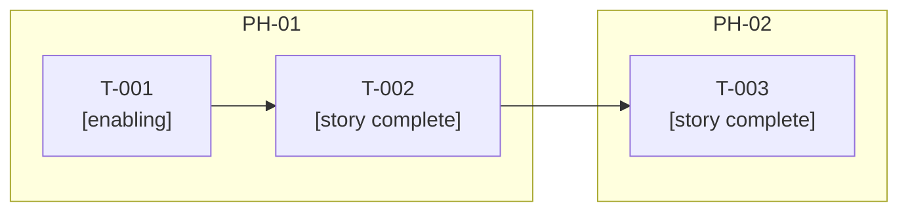
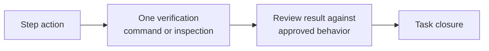

# Release Tasks: vX.Y.Z

> **Authoring notes (delete when filling in).**
> - The frontmatter `tasks` array owns every executable definition. The reading tables below mirror it; update the array first, then synchronize the views in the same revision.
> - **Keep the frontmatter short.** Write lists and mappings in one line (flow style), as in the example. Formatting does not change the document digest. Anchors, aliases, merge keys, and explicit tags are rejected, so repeated text cannot be shared.
> - **Size rule: about 10 tasks per release at most.** The array lives entirely in the frontmatter, so its length grows with every task. Past roughly 10 tasks (or about 80 frontmatter lines), the release is probably too large: return to the roadmap and split it into smaller releases, each with its own spec, plan, and tasks. Record the decision in the Decomposition criteria table.
> - **Minimal text in the array.** Keep `action`, `expected`, and `closure` to one sentence each, citing the `AC`, `NFR`, or plan section. Detail, rationale, and context belong in the body tables, which add no frontmatter length.
> - **Group steps by observable check, not by code edit.** One step proves one result; several edits that serve that result go into its `action`. Aim for one to three steps per task. A task that needs more probably bundles unrelated outcomes: split it.
> - **Cite instead of copy.** Execution-critical detail may live in a named approved source. Let `action` and `closure` cite the `AC`, `NFR`, or plan section rather than restating it.
> - Task IDs are `T-` plus at least three digits. Step IDs are the task ID plus a dot and at least three digits, for example `T-001.001`. Phase and story must exist in the plan and spec. Each acceptance ID must belong to the task's story. Dependencies must exist and form no cycle.
> - List files one by one, relative to the project root, tests included. No wildcards. Never target `.specs/`, `.spec-flow/`, or `.git/`. Files from earlier tasks are context only and grant no write permission.
> - Each step has one action, exactly one verification (a nonempty argv `command` list **or** a specific `inspection` string), and an `expected` result. Commands run from the project root, print meaningful output, and never change project code. Implementation, generation, and migration belong in actions, with a separate check.
> - An exit code alone does not prove acceptance. Review results against the approved behavior. Inspections name the surface, the conditions, and the observable evidence.
> - Every spec `AC` appears exactly once, under its real story. The tasks listed for an `AC` must be exactly the tasks whose `acceptance` includes it. Each `AC` needs a named final-verification step; none may rest only on partial tasks or a promise of later checks.
> - Label enabling and partial-contribution tasks. Execution is sequential, one task at a time, even for logically independent tasks.
> - Never invent stories or `AC` links to pass validation. Route changed behavior to the spec, a changed solution or phases to the plan, and shared changes to their owner.
> - Leave the Approval cell of the revision row as it is. The `approve` operation rewrites it, then records the digest. Add a new revision row with the same marker for each later revision.
> - Write content in the project's language. Keep headings and column names. Replace every `[bracketed guide]`, or write `N/A` plus the reason. Prefer tables, lists, and diagrams; keep paragraphs short.
> - **Count check (compact style).** Tasks: `grep -c '^- id: T-' tasks.md`. Steps: `grep -o '{id: T-[0-9]*\.[0-9]*' tasks.md | wc -l`. The totals in the Task map must equal these numbers.
> - Before approving: compare counts, order, and values between the array and the tables; validate the document; then validate the whole release with `{"release":"vX.Y.Z"}`. The controller checks structure and nominal coverage only, not feasibility.

## Purpose and approved bases

[One or two sentences: which release these tasks deliver and from which approved plan.]

| Field | Value |
|-------|-------|
| Release | [vX.Y.Z] |
| Approved plan | [plan.md, revision] |
| Approved spec | [spec.md, revision] |
| Objective | [Release objective from the roadmap] |

| Approved base | Revision | Decision used |
|---------------|----------|---------------|
| [Shared design or constitution rule, if applicable] | [R00] | [What it constrains in the tasks] |

## Decomposition criteria

[One sentence on how work was split. Tasks are specific, measurable, bounded, and reviewable.]

| Criterion | Rule applied |
|-----------|--------------|
| Grouping | [By story and real prerequisites within plan phases] |
| Splitting | [Split tasks that bundle unrelated outcomes or are too large or uncertain to verify] |
| Release size | [Task count against the limit of about 10; if exceeded, the split into smaller releases or the reason to keep it whole] |
| Step size | [One step per observable check; edits grouped in the action] |
| Enabling and partial work | [Allowed when labeled in the task map and closure] |
| Tests and checks | [Integrated into every task, not deferred] |
| Exploration | [Only with a question, boundary, expected evidence, stop condition, and explicit files; otherwise return to the plan] |

| Task group | Estimate | Basis | Uncertainty |
|------------|----------|-------|-------------|
| [Tasks or phase] | [Effort or pending] | [How it was estimated] | [Low, Medium, or High, with reason] |

## Task map

[One sentence: the totals and the table below are reading views of the `tasks` array. Each task appears once, in the same order.]

**Totals**

| Scope | Tasks | Steps | Enabling | Partial | Complete |
|-------|-------|-------|----------|---------|----------|
| Release | [n] | [n] | [n] | [n] | [n] |

> Optional per-phase and per-story breakdowns. Each is a hand-kept count: skip them when the Tasks table below already shows the same information.

| Phase | Tasks | Steps |
|-------|-------|-------|
| [PH-01] | [n] | [n] |
| [PH-02] | [n] | [n] |

| Story | Tasks | Criteria covered |
|-------|-------|------------------|
| [US-001] | [n] | [AC-001, AC-002, AC-003] |
| [US-002] | [n] | [AC-004] |

**Tasks**

| Task | Phase | Story | Contribution | Related criteria | Dependencies | Closure condition |
|------|-------|-------|--------------|------------------|--------------|-------------------|
| T-001 | [PH-01] | [US-001] | [Enabling or Partial or Complete] | [AC-001] | None | [Same text as the array closure] |
| T-002 | [PH-01] | [US-001] | [Complete] | [AC-001, AC-002, AC-003] | [T-001] | [Same text as the array closure] |
| T-003 | [PH-02] | [US-002] | [Complete] | [AC-004] | [T-002] | [Same text as the array closure] |

## Sequence and dependencies

[One sentence on the execution order. Logical independence does not authorize parallel work.]

> Optional diagram. It must match the array and the plan's phase graph.

- **Ordering rationale:** [Real prerequisites and what each task unlocks].
- **Plan alignment:** [How the task graph respects the phase dependencies].

## File scope and restrictions

[One sentence on where changes land. Distinguish existing from proposed files.]

| File | State | Tasks | Purpose |
|------|-------|-------|---------|
| [relative/path] | [Existing or Proposed] | [T-xxx] | [What changes] |

| Excluded area | Reason |
|---------------|--------|
| `.specs/`, `.spec-flow/`, `.git/` | [Protected metadata; never a task target] |
| [Other off-limits path] | [Reason] |

## Acceptance and quality coverage

[One sentence: this table shows intended contributions and final checks, not completed acceptance.]

| Criterion | Owning story | Contributing tasks | Final verification step | Quality reference |
|-----------|--------------|--------------------|-------------------------|-------------------|
| AC-001 | [US-001] | [T-001, T-002] | [T-002.001] | [None] |
| AC-002 | [US-001] | [T-002] | [T-002.001] | [None] |
| AC-003 | [US-001] | [T-002] | [T-002.002] | [NFR-001] |
| AC-004 | [US-002] | [T-003] | [T-003.001] | [None] |

| Check | Linked through | Task step |
|-------|----------------|-----------|
| [Constitution MUST rule or NFR] | [AC or plan reference] | [T-xxx.xxx] |

- **Partial contributions:** [Tasks that contribute without finishing a criterion].

## Verification and evidence

[One sentence on how each step proves its result.]

| Step | Method | Runs from or inspects | Expected evidence | Changes project code |
|------|--------|-----------------------|-------------------|----------------------|
| [T-xxx.xxx] | [Command or Inspection] | [Project root, or the surface and conditions] | [Observable result] | No |

## Risks, blockers, and readiness

[One sentence on what could stop execution.]

| Risk or uncertainty | Consequence | Response | Task or phase |
|---------------------|-------------|----------|---------------|
| [Description] | [Impact] | [Action] | [T-xxx or PH-xx] |

| Blocker | Blocks | Owner | Needed by |
|---------|--------|-------|-----------|
| [Condition or missing decision] | [T-xxx] | [Role or person] | [Date or phase] |

| Readiness check | Result | Note |
|-----------------|--------|------|
| Approved bases are current | [Met, Not met, or N/A] | [Comment] |
| Tasks defined across all phases | [Result] | [Comment] |
| Every `AC` covered with a named final check | [Result] | [Comment] |
| Dependency graph executable; tables match the array | [Result] | [Comment] |
| Totals in the Task map match the array counts | [Result] | [Comment] |
| Release size within about 10 tasks, or split justified | [Result] | [Comment] |
| File scope valid | [Result] | [Comment] |
| Verifications usable and blockers resolved | [Result] | [Comment] |

## Closure and progress

[One sentence: a task closes only when its steps' verifications pass. Checkboxes are generated views, not proof.]

| Task | Contributes to criteria | Release completion link |
|------|-------------------------|-------------------------|
| [T-xxx] | [AC-xxx] | [How it moves the release toward done] |

## Refinement, references, and approval

[One sentence: approving tasks is distinct from authorizing implementation, and neither permits integration, publication, or deployment. The controller registry is the approval authority.]

| Document | Revision | Digest (first 8 characters) | Purpose |
|----------|----------|-----------------------------|---------|
| [plan.md](plan.md) | [R00] | [00000000] | [Pinned source] |

| Revision | Date | Approval | Summary of change | Documents affected |
|----------|------|----------|-------------------|--------------------|
| R00 | [YYYY-MM-DD] | <!-- spec-flow:approval -->Pending approval<!-- /spec-flow:approval --> | [First draft] | [None] |

- **Stable IDs:** [Completed work, evidence, and IDs are preserved on refinement; new work gets new IDs].

<!-- spec-flow:generated:start -->
Progress is maintained by the Spec-Flow harness.
<!-- spec-flow:generated:end -->
